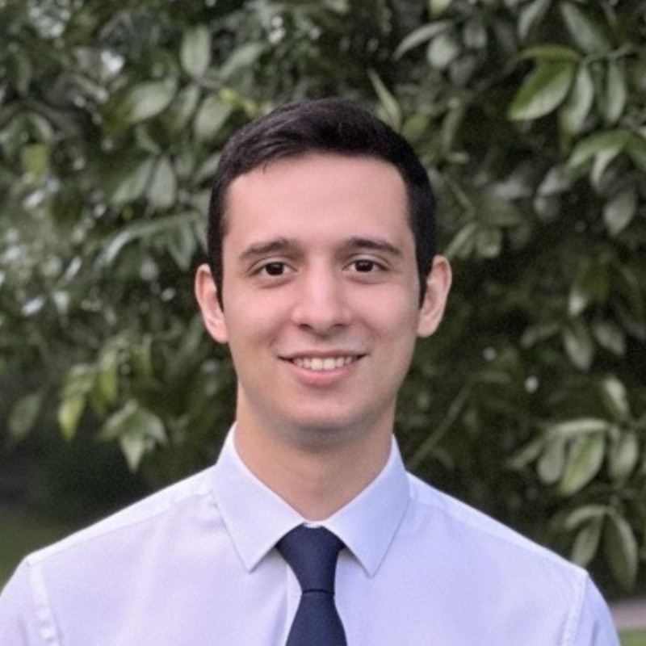

:::::: {.home}

<h1 class="home-name">Ali Yaraghi</h1>

::: {.home-role}
Final-year Data Science & Artificial Intelligence @ Maastricht University
:::

::::: {.home-intro}

:::: {.home-bio}
I am a final-year honours student in Data Science and Artificial Intelligence at Maastricht University, expected to graduate *Summa Cum Laude*. My research interests center on reinforcement learning. I am interested in how rewards shape what agents learn, why agents sometimes earn high reward without solving the task (reward hacking), and how they adapt to new tasks and to the real world.

As a student researcher at [Turing](https://www.turing.com), I analysed coding agents' trajectories on long-horizon tasks and worked on training/evaluation tasks with continual rewards. In my own experiments, I study how RLVR training affects models' behavior in different ways. In my Honours research internship at [Pie Medical Imaging](https://www.piemedicalimaging.com), I am developing algorithms and building models using graph and geometric approaches to 3D cardiac CT.

I am also interested in where RL meets robotics, bioinformatics, causality, and game theory.

I am currently applying for PhD and MSc programs starting in fall 2027.
::::

:::: {.home-photo}
{fig-alt="Portrait of Ali Yaraghi"}

[Maastricht, the Netherlands]{.photo-caption}
::::

:::::

## news

::: {#news}
:::

::: {.section-head}
## latest posts

[all posts →](blog/index.qmd)
:::

::: {#latest-posts}
:::

::: {#selected-publications}
:::

::::::
